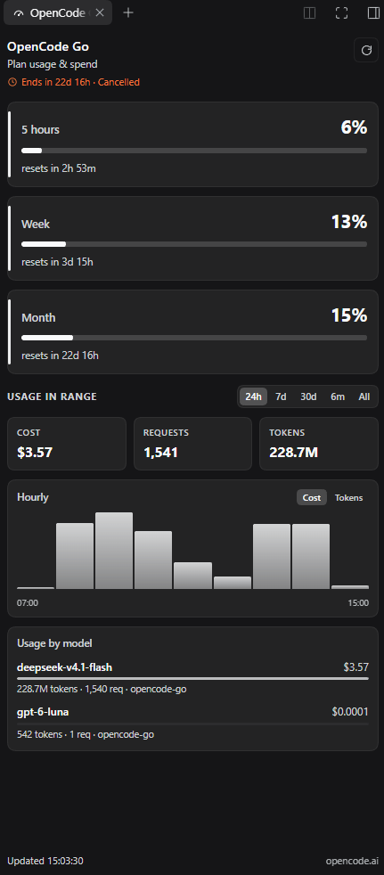

# dsh-opencode-go-usage

OpenCode Go plan usage and spend in the DeepSeek Harness Web UI right sidebar.



## Install

Add the bundle to a DSH profile with the spec:

```
github:voquochung2210/dsh-opencode-go-usage
```

or install the tarball from [Releases](https://github.com/voquochung2210/dsh-opencode-go-usage/releases).
Installing enables the bundle, so the tab appears on the next page load.

## What the tab shows

Under the panel subtitle sits the **subscription line**: a clock and the time
left on the paid period — `Ends in 22d 16h · Cancelled` when the plan is
cancelled but still usable, `Renews in …` while it renews. It is tinted warm
when the subscription will not renew, and switches to `Subscription ended`
once the period is over.

**Plan meters** — the three windows the OpenCode Go plan reports:

| Window | Upstream key | Meaning |
| --- | --- | --- |
| 5 hours | `usage.rolling` | rolling five-hour window |
| Week | `usage.weekly` | current plan week |
| Month | `usage.monthly` | current plan month |

Each row shows the used percentage, a bar tinted by pressure (blue → amber at
60 % → red at 85 %), and when the window resets.

**Usage in range** — a time-range picker (`24h`, `7d`, `30d`, `6m`, `all`)
followed by:

- three tiles: total cost (USD), requests, tokens (with an input/output/cache
  breakdown on hover);
- a chart of cost or tokens over time — hourly buckets for `24h`, daily buckets
  otherwise — with a cost/token toggle;
- usage by model: the six costliest models for the range with their share of
  the range's spend, token count, request count, and provider.

## Where the numbers come from

`opencode.ai` exposes the data the console's "My usage" page shows:

| Endpoint | Used for |
| --- | --- |
| `GET https://opencode.ai/zen/go/v1/usage` | the three plan percentages |
| `GET https://opencode.ai/console/api/go/status` | subscription period and cancellation |
| `GET https://opencode.ai/console/api/usage/summary?range=…` | cost, requests, tokens |
| `GET https://opencode.ai/console/api/usage/models?range=…` | usage by model |
| `GET https://opencode.ai/console/api/usage/cost-by-day?range=…&bucket=…` | chart series |

All of them accept the OpenCode Go API key as `Authorization: Bearer …`; no
browser session is needed. Ranges are `24h`, `7d`, `30d`, `6m`, `all`; the chart
bucket is `hour` for `24h` and `day` for everything else. Costs upstream are
micro-cents (`1e8` per USD).

The Host half (`lib/index.js`) resolves the key without asking for it again:

1. `OPENCODE_GO_API_KEY`, when set;
2. otherwise the `opencode-go` (then `opencode-zen`, `opencode`) entry in
   `~/.local/share/opencode/auth.json`, i.e. whatever `opencode auth login`
   stored. `XDG_DATA_HOME` is honored.

It then serves `GET /opencode-go-usage/status` on the Harness web server, so the
browser half never touches a credential.

Query parameters: `range` (one of the five ids, defaults to `24h`) and
`refresh=1` to bypass the cache.

Response shape:

```json
{
  "ok": true,
  "fetchedAt": "2026-11-05T07:11:30.000Z",
  "elapsedMs": 812,
  "range": "24h",
  "source": "https://opencode.ai/zen/go/v1/usage",
  "keySource": "auth.json:opencode-go",
  "windows": {
    "session": { "percent": 3, "status": "ok", "resetsAt": "2026-11-05T10:56:59.000Z" },
    "week": { "percent": 12, "status": "ok", "resetsAt": "2026-11-09T00:00:00.000Z" },
    "month": { "percent": 15, "status": "ok", "resetsAt": "2026-11-28T00:31:47.000Z" }
  },
  "subscription": {
    "endsAt": "2026-11-28T00:31:47.000Z",
    "startsAt": "2026-10-28T00:31:47.000Z",
    "cancelAtPeriodEnd": true,
    "cancelled": true,
    "stopReason": "cancelled_by_user",
    "resumability": "resumable",
    "product": "go"
  },
  "stats": {
    "ok": true,
    "fetchedAt": "2026-11-05T07:11:30.000Z",
    "elapsedMs": 812,
    "bucket": "hour",
    "totals": {
      "requests": 5225,
      "cost": 8.85081873,
      "tokens": {
        "input": 1203400,
        "output": 2980000,
        "cacheRead": 813000000,
        "cacheWrite": 410000,
        "total": 819397168
      }
    },
    "models": [
      {
        "model": "deepseek-v4.1-flash",
        "provider": "opencode-go",
        "requests": 4205,
        "cost": 8.25,
        "tokens": { "input": 1000000, "output": 2400000, "cacheRead": 695000000, "cacheWrite": 300000, "total": 699489938 }
      }
    ],
    "series": [
      { "at": "2026-11-05T00:00:00Z", "cost": 0.12, "requests": 41, "tokens": 6200000 }
    ]
  }
}
```

On failure it answers `{ "ok": false, "error": { "code": "...", "message": "..." } }`
with `code` one of `no_auth`, `auth_unreadable`, `no_key`, `unauthorized`,
`network`, `upstream`, `bad_range`, `method_not_allowed`, `internal`.
A bad range is a `400`; a failure of the spend endpoints alone leaves `windows`
intact and reports `stats: { "ok": false, "error": … }` instead, so the plan
meters still render. A failure of `go/status` only leaves `subscription` null,
which hides the subscription line.

Caching: plan meters for 30 s, spend per range for 120 s, failures for 8 s.
Requests for the same range share one upstream fetch.

## Panel behavior

- Refreshes every 60 s while visible, and again when the tab becomes visible.
- Manual refresh button (the Host honors `?refresh=1` and bypasses its cache).
- Switching range refetches; the previous range's numbers are hidden until the
  new answer arrives.
- A failed refresh keeps the last good numbers on screen above the error box.
- Copy is localized through the `opencodeGoUsage` locale namespace
  (`en`, `vi`, `zh`), falling back to English for unknown keys.

## Install on another machine

The plugin is portable; only the OpenCode Go credential is machine-local.
Prerequisites on the new machine:

1. DeepSeek Harness installed.
2. A Go credential the Host can read: run `opencode auth login` and pick
   OpenCode Go (the plugin reads `~/.local/share/opencode/auth.json`), or set
   `OPENCODE_GO_API_KEY` before launching DSH.

Then install the bundle with any spec the plugin manager accepts (`registry`,
`path`, `git` or `tarball`), for example:

| Source | Spec to paste |
| --- | --- |
| git repository (this repo) | `github:voquochung2210/dsh-opencode-go-usage` (or `git+https://github.com/voquochung2210/dsh-opencode-go-usage.git`) |
| tarball on disk | `D:\path\to\dsh-opencode-go-usage-0.3.0.tgz` |
| tarball URL (release asset) | `https://github.com/voquochung2210/dsh-opencode-go-usage/releases/download/v0.3.0/dsh-opencode-go-usage-0.3.0.tgz` |
| npm | `dsh-opencode-go-usage` once published (drop `"private": true` first) |

Use **Settings → Plugins → install** in the Web UI, or have an agent run the
`plugin_manager` install action with that spec. Installing enables the bundle,
so the `OpenCode Go` tab appears in the right sidebar on the next page load.
Check the Host half with `GET /opencode-go-usage/status`.

To rebuild the tarball after a change: bump `version`, then
`npm pack --pack-destination ..\dist`.

## Layout

```
package.json          dsh.bundle.patch + dsh.client
cordis.patch.yml      inserts the Host plugin row
lib/index.js          Host: key resolution, upstream calls, HTTP route, caches
lib/client.js         Client: right-sidebar tab type, title, panel body, styles
locale/{en,vi,zh}.json  plugin display metadata
icon.svg              plugin icon
```

The tab registers with the `sidebarRightTabs` service as kind
`opencode-go-usage`, id `dsh-opencode-go-usage`, priority `extension`, and
mounts its body in the `sidebar.right.pane.tab` slot under that same id.
